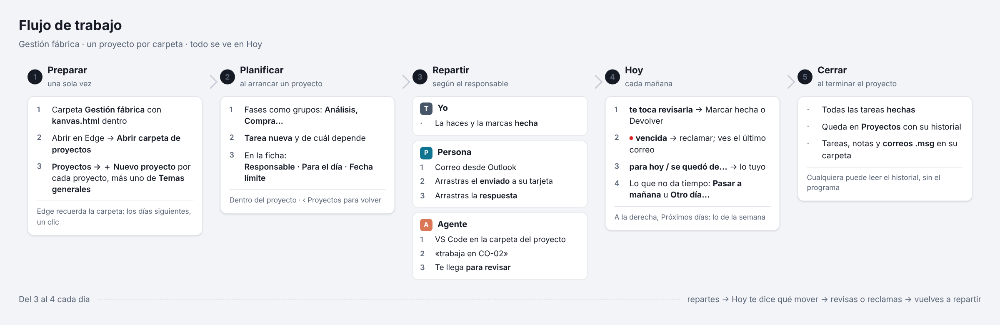

# Gestión fábrica

Kanvas adaptado para llevar los proyectos de la fábrica desde un PC con Windows y Edge, sin instalar nada: un tablero por proyecto, una pestaña **Hoy** que reúne lo que toca cada día, responsables (tú, una persona o un agente) y correos de Outlook guardados en cada tarea.

## Empezar

Copia esta carpeta del repositorio al PC, abre VS Code en ella y dile a tu agente:

> Sigue `gestion-fabrica/PREPARAR.md` y déjalo todo preparado.

Te preguntará dónde crear la carpeta y qué proyectos quieres, y la dejará lista. Después abre `kanvas.html` en Edge y pulsa **Abrir carpeta de proyectos**.

## Flujo de trabajo

1. **Preparar** (una vez): la carpeta de proyectos. Edge la recuerda; los días siguientes basta un clic.
2. **Planificar** (al arrancar un proyecto): en **Proyectos**, abre el proyecto, crea las fases como grupos y las tareas con **Tarea nueva**. En la ficha de cada tarea: **Responsable**, **Para el día** y **Fecha límite**.
3. **Repartir**, según el responsable:
   - **Yo**: la haces y la marcas hecha.
   - **Persona**: le escribes desde Outlook, arrastras el correo enviado encima de su tarjeta y, cuando conteste, arrastras la respuesta. Quedan guardados en la tarea y en la pestaña **Correos** del proyecto.
   - **Agente** (Cualquiera, Claude o Copilot): abres la carpeta del proyecto en VS Code y le dices «trabaja en CO-02». Trabaja con los comandos de Kanvas, que solo le dejan coger las tareas que son suyas, y te la deja para revisar.
4. **Hoy** (cada mañana): por cada proyecto, lo que te toca. Revisa lo que te espera, reclama lo vencido (punto rojo), haz lo tuyo y pasa a mañana u otro día lo que no dé tiempo. A la derecha, **Próximos días**.
5. **Cerrar**: con todas las tareas hechas, el proyecto queda en **Proyectos** con su historial: tareas, notas y correos en su carpeta.

## Limitaciones conocidas

- Arrastrar un correo desde Outlook clásico a Edge está por probar en el PC. Si no llega, arrástralo antes al escritorio y desde ahí a la tarea.
